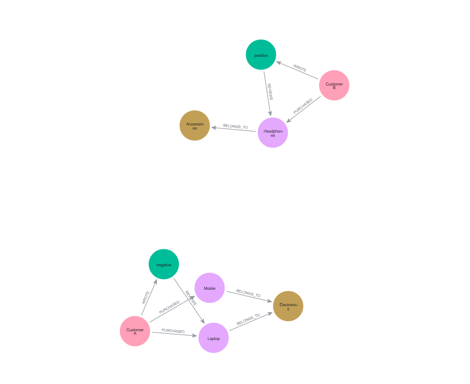

# E-Commerce Orders & Reviews

This repository contains my solution to the E-Commerce Orders & Reviews assignment. It covers data cleaning and sales analysis using Python, evaluation of LLM-generated sentiment labels, and knowledge graph modelling using Neo4j and Cypher.

## Part A: E-Commerce Orders Analysis

**Tools:** Python, Pandas, Google Colab

Tasks performed:
- Cleaned inconsistent product and category names.
- Handled missing category values.
- Calculated revenue for each order.
- Summarized revenue by product category.
- Identified the top 2 best-selling products by quantity.

### Results

**Revenue by category**

| Category    | Revenue |
|-------------|---------|
| Electronics | 100.0   |
| Fitness     | 105.0   |
| Home        | 25.0    |

**Top 2 best-selling products**

| Product        | Quantity sold |
|----------------|---------------|
| Yoga Mat       |       7       |
| Wireless Mouse |       5       |

Files:
- `part-a-orders-analysis/e_commerce_orders_analysis.py` – Python source code.
- `part-a-orders-analysis/E_Commerce_Orders_Analysis.ipynb` – Google Colab notebook with code and outputs.

## Part B1: Sentiment Evaluation

Compared four LLM-generated sentiment predictions against their reference labels.

**Evaluation result:**
- Total reviews: 4
- Correct predictions: 2
- Accuracy: 50%

Also analysed the mixed and neutral sentiment cases where the LLM predictions differed from the reference labels.

See [`sentiment_evaluation.md`](part-b1-sentiment-evaluation/sentiment_evaluation.md) for the detailed evaluation and discussion.

## Part B2: Knowledge Graph Modelling

**Tool:** Neo4j, Cypher

Created a knowledge graph containing the following node types:
- Customer
- Product
- Category
- Review

### Relationships

- Customer — PURCHASED → Product
- Product — BELONGS_TO → Category
- Customer — WROTE → Review
- Review — REVIEWS → Product

### Query objective

Retrieve all products purchased by customers who have written at least one negative review.

**Query result:**

| Product |
|---------|
| Laptop  |
| Mobile  |

### Graph visualization

Files:
- `knowledge_graph.cypher` – Graph creation, visualization, and retrieval queries.
- `knowledge_graph.docx` – Queries and screenshots of outputs.
- `visualisation.png` and `visualisation.svg` – Graph visualization files.
- `neo4j_query_table_data.csv` and `neo4j_query_table_data.json` – Query result data.

## Technologies Used

- Python
- Pandas
- Google Colab
- Neo4j
- Cypher
- GitHub
